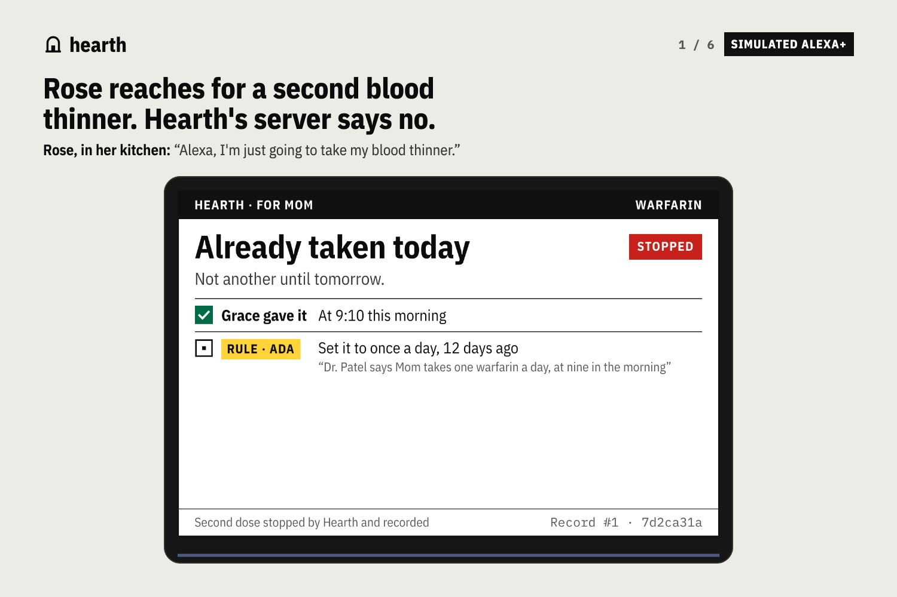

# Hearth

**The memory and the conscience of a family caring for someone.
An Alexa+ add-on, built as a self-hosted MCP server.**

> **Rose, 84, in her kitchen:** Alexa, I'm just going to take my blood thinner.
>
> **Alexa:** Hold on, Rose. Grace gave you today's warfarin at 9:10 this morning.
> Your warfarin is once a day, so not another until tomorrow.



[Listen to the whole household (2 min)](demo/hold-on-rose.m4a) ·
[transcript](demo/transcript.md). Every Alexa line is Hearth's real answer,
except the order confirmation after "Yes, go ahead", which is the host's (the
part Alexa+ plays in checkout), built from the completed checkout session.

Nobody told Alexa that in the moment. Grace, the home aide, logged the morning
dose four hours earlier. Ada, Rose's daughter, set the rule twelve days ago from
the cardiologist's letter. Hearth held both, and it was Hearth, not the language
model, that refused the dose and wrote the refusal down.

## Why this matters

**63 million Americans** are family caregivers, nearly 50% more than in 2015
([AARP and the National Alliance for Caregiving, 2025](https://www.aarp.org/pri/topics/ltss/family-caregiving/caregiving-in-the-us-2025/)).
Care for one parent is split between a daughter with the doctor's letters, a son
two states away, a paid aide on weekday mornings, and the parent herself, who
forgets. Nobody holds the whole picture, and the gaps are where people get hurt.

Older Americans have about **100,000 emergency hospitalizations a year** for
adverse drug events. Two thirds are **unintentional overdoses**, and **warfarin
is involved in a third** of them
([Budnitz et al., NEJM 2011](https://pubmed.ncbi.nlm.nih.gov/22111719/)).

The one device in that house that hears everybody is the speaker in the
kitchen. Alexa+ can act now, which makes it useful there and dangerous there:
an assistant that acts on a family's behalf has to know who said what, whose
word counts, what has already been done today, and it has to be able to say
why.

## What Hearth does

| | |
|---|---|
| **Stops the second dose** | `give_dose` checks the family's rule (once a day, set by Ada, who holds the health care proxy) against today's record (given 9:10, by Grace) and refuses. In code, on the server: once the assistant reports the dose, nothing the model says can turn the refusal into a yes. "Warfarin sodium", "Jantoven 5 mg" and "her Coumadin" all reach the same rule, and a medicine with no rule gets "check with Ada", never "logged". |
| **Sorts it out in one request** | "Mom's cardiology moved to Thursday at ten, sort it out." Calendar moved, Tom assigned because the family rota says he does Thursdays, Tuesday's ride cancelled, a new ride booked for 9:15, a note left for Tom and Grace on the family board and pushed to Tom's phone, and a dose that falls during the trip called out. Five steps in one tool call, every step on the record. Calendar, rota and board are Hearth's own books; the ride provider is a sandbox; the phone push is real (ntfy or any webhook, `HEARTH_NOTIFY_<NAME>`). |
| **Remembers across sessions and devices** | Tom, on his own (simulated) Echo Dot that evening: "What did I miss with Mom?" Hearth knows when he last talked to the house and tells him only what changed since, including the dose it stopped. |
| **Settles disagreements, and says how** | Tom says Mom can have coffee till six; Ada said three because it keeps her up. "Mom's coffee stops at three. Tom said six, but Ada has the say over what she eats and drinks." A medication rule from someone without the say is only a proposal: "Ada has the say over Mom's warfarin, so it stays once a day until Ada confirms." |
| **Lets situations end** | "No wine while she's on the antibiotics" holds until "Mom finished the antibiotics", then stops applying by itself. |
| **Buys, the Alexa+ way** | "We're nearly out of her warfarin, reorder it" prices the refill against the family's spending limit and last week's orders, and offers Pay. Per the Alexa+ payments docs, Alexa+ then opens the checkout session on Hearth's Universal Commerce Protocol endpoints, takes the PIN and the card, and completes it; in this build the simulated client plays that part against a sandbox merchant. Hearth never charges anything itself. |
| **Keeps an honest record** | Every tool call is written by the server as it happens, with what it read and wrote. Entries are hash-chained, and after each one the server signs the new head (Ed25519) into a witness file kept apart from the record, so cutting entries off the end, or editing, deleting or reordering one and recomputing the hashes, fails the check. Every result also hands the client a receipt; a receipt kept off the server catches even a rewrite by someone holding the signing key, up to that receipt. If the assistant reports an action it never checked with Hearth first, "why did you do that?" says so. |
| **Draws it on the screen** | Results carry an MCP Apps card (`ui://hearth/card-…`), sized for the Echo Show, and a complete spoken sentence for a speaker with no screen. |

## How it is built

```
 Alexa+ (or the simulated client at /alexa)
    │  MCP 2025-11-25 · Streamable HTTP · OAuth 2.1 + PKCE (S256)
    ▼
 /mcp ──► HearthMCP ──► every tools/call written to the record (SHA-256 chain,
                         head signed into a separate witness file, receipt to the client)
              │
              ├── beliefs: who said it, when, about whom, in what situation
              │     resolved by scope, then authority, then recency, with a reason
              ├── care: doses · appointments · rota · rides* · family board
              ├── checkout: /checkout-sessions (UCP shape) · pharmacy*
              └── MCP App: resources/read ui://hearth/card-<hash>.html
                                                    * sandbox providers
```

- **MCP spec 2025-11-25 over Streamable HTTP**, hand-rolled, 13 tools with
  annotations, `structuredContent` on every visual result, and an
  [MCP Apps](https://github.com/modelcontextprotocol/ext-apps) view named in
  `_meta.ui.resourceUri` on both the tool and the result (the Alexa+ docs read
  it from the result, the MCP Apps spec from the tool).
- **OAuth 2.1 authorization code flow with PKCE S256**, both well-known
  documents, and the three places Alexa+ departs from stock MCP: a `401` with
  no `WWW-Authenticate`, both metadata documents required, bearer tokens in the
  query string refused.
- **MCP transport rules checked by the official suite.** Origin and Host
  validated (403), unsupported `MCP-Protocol-Version` refused (400), session
  required after `initialize` (400), JSON-RPC batches refused, bad arguments
  returned as `isError` results. `scripts/conformance.sh` runs
  [`@modelcontextprotocol/conformance`](https://github.com/modelcontextprotocol/conformance)
  0.1.16 and passes all 6 scenarios that apply to Hearth; the other 24 call the
  reference server's fixture tools or capabilities Hearth does not declare
  (`--all` runs them anyway). CI runs it as its own job.
- **No model on the read path.** Resolving what is true is a dictionary lookup,
  so the server's share of the 500 ms Alexa+ allows is tiny; the rest is
  network. The server's own share is stamped on each response in `Server-Timing`: p50 about 0.1 ms for
  `check_dose` on our test box, flat from the first call to the 5,000th
  (`scripts/trace_latency.py`; the record is appended, never rewritten).
- **One household per account**, isolated, persisted to disk.

## Try it

```bash
pip install -r requirements.txt
uvicorn hearth.app:app --port 8000
open http://localhost:8000/alexa        # the simulated Alexa+ client
```

Press **→** to play the scenes, or pick a person and type (or press Mic in
Chrome). The right-hand panel is the live MCP traffic.

**The client is a simulation, and says so on screen.** Alexa+ add-on tooling
is available to select partners only, so it is not open to hackathon
entrants. `/alexa` is a real MCP client standing in for it: it authorises with
PKCE, opens an MCP session per device, lists tools, reads Hearth's MCP App and
hosts it the way an Echo Show would, and calls tools over Streamable HTTP. What
it cannot be is Alexa's language model. A language model
on Amazon Bedrock (Converse API, any OpenAI-compatible endpoint as a fallback)
stands in for Alexa's: it is given Hearth's real `tools/list` and Hearth's Agent
Skill, and chooses every tool call; the header names the model. Two things never
depend on its reading, and the header says when either steps in: a question
never records a dose, and a dose being taken always reaches `give_dose`. With no
model configured, offline rules plan instead, and the header says so. Every word the
assistant says is the text Hearth returned, apart from the host's own checkout
confirmation. `?film=1` is the full-width view used for the video.

Voice: Amazon Polly neural if AWS keys are set (the request signing is
unit-tested, but this path has not yet been run against AWS), otherwise
[Piper](https://github.com/rhasspy/piper) offline (`pip install -r requirements-sim.txt`,
then set `HEARTH_PIPER_VOICE` to a voice model), otherwise the browser's voice.
See `.env.example`.

**Any MCP client can use it.** The official MCP Python SDK client talks to it
unmodified (`tests/test_interop.py`). `demo/assistant.py` is written to run
Claude Code as a client with Hearth's Agent Skill (`skills/hearth-care/SKILL.md`)
as its instructions; it has not yet been run end to end (it needs a logged-in
`claude`).

**On a real Echo, today.** `skill/` is a classic Alexa custom skill (ASK SDK
for Python) whose handler is an MCP client of Hearth: Alexa's NLU picks the
intent, the skill makes the Hearth `tools/call` over Streamable HTTP, says
Hearth's text verbatim and draws Hearth's card in APL on an Echo Show.
`skill/tests/test_skill.py` drives the real handler against a running Hearth
for all nine scenes. It has not been deployed to Amazon yet; `skill/README.md`
has the steps.

To reach it from Alexa+ once the toolkit is available to you:

```bash
cloudflared tunnel --url http://localhost:8000
alexa-ai new mcp --name "Hearth" --mcp-server-url https://<tunnel>/mcp
```

## Tests

```bash
for t in tests/test_*.py; do [ "$t" = tests/test_live.py ] || python3 $t; done
python3 tests/test_live.py https://<deployment>    # the same checks over the network
```

204 tests, all green: 68 conformance (the Alexa+ requirements as documented,
plus the MCP 2025-11-25 transport rules), 37 care and record (truncation,
edit-and-rehash, reorder and deletion of the record all caught), 8 dose
safety (questions never log a dose), 3 phone notification, 23 contest
resolution, 18 phrasing, 17 extraction, 9 listing, 12 simulator (including the
Bedrock planner against a fake Converse endpoint), 8 for the
classic Alexa skill (`python3 skill/tests/test_skill.py`), and one interop test
in which the **official MCP Python SDK client** (`pip install -r
requirements-dev.txt`) negotiates 2025-11-25 with Hearth over a real socket,
lists the tools, gets the refused dose with its card, and closes its session.
`scripts/conformance.sh` runs the official MCP conformance suite (needs node).
The Alexa+-specific checks are also packaged on their own as a pytest plugin
and GitHub Action, [`alexa-plus-mcp-checks`](https://github.com/ubmids/alexa-plus-mcp-checks).
`python3 demo/shots.py http://localhost:8000 shots` plays every scene on the
simulated client in a headless browser and fails on any page error. Parts of the
suite came from hand mutation testing: `oauth.py`, `household.py` and `app.py`
were mutated one change at a time, and each surviving mutant became a test
(marked in `tests/test_conformance.py` and `tests/test_contest.py`). There is no
mutation-score report.

## What is real and what is not

- Real: the MCP server, OAuth, the record and its signed checkpoints, the
  refusals, the resolution, the MCP App, the checkout endpoints, the simulated
  client's MCP traffic, and the push to a family member's phone when a channel
  is configured.
- Hearth's own books, not outside services: the calendar, the rota, the dose
  book and the family board live in Hearth's process and data files.
- Sandbox: the ride provider and the pharmacy. Nothing books a car or charges a
  card. Both are named "sandbox" wherever they appear.
- Simulated: Alexa+ itself (see above). The classic Alexa skill in `skill/`
  is real Alexa, but it is a classic custom skill, not an Alexa+ add-on, and it
  has been tested locally only so far.
- The planner: a model on Bedrock (or any OpenAI-compatible endpoint) when one
  is configured, with a guard that keeps questions from logging doses and dose
  reports from being missed; offline rules otherwise.
  `docs/LOCAL_PLANNER.md` measures a 3B model on CPU as the planner (right tool
  every time, 3–9 s a line: not fast enough for camera).
- Not a medical device. Hearth enforces the rules the family gives it; it does
  not know pharmacology. The rule extractor without a model key is a small,
  deterministic set of patterns; `HEARTH_LLM_*` is wired for any
  OpenAI-compatible model on the write path, but has only been run against a
  test stub, so in every configuration that has actually run, writes go
  through the patterns.

## More

- [docs/SUBMISSION.md](docs/SUBMISSION.md) — the Devpost copy
- [docs/DEMO_SCRIPT.md](docs/DEMO_SCRIPT.md) — the video, second by second
- [docs/FRICTION_LOG.md](docs/FRICTION_LOG.md) — building for Alexa+, honestly
- [docs/ENGINEERING.md](docs/ENGINEERING.md) — latency, the record, the bugs that shaped it
- [skills/hearth-care/SKILL.md](skills/hearth-care/SKILL.md) — an Agent Skill that teaches any agent to use Hearth safely

Built for Build, Ship, Shape: the Amazon Developer Hackathon 2026, Alexa+ track.
MIT licence.
